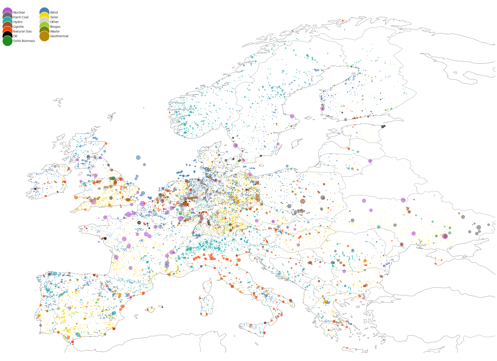

<!--
SPDX-FileCopyrightText: 2025 Contributors to powerplantmatching <https://github.com/pypsa/powerplantmatching>

SPDX-License-Identifier: MIT
-->

# Getting Started

This guide will help you get started with Powerplantmatching.

## Get the Data

To directly load the already built data into a pandas dataframe, just call:

```python
import powerplantmatching as pm

pm.powerplants(from_url=True)
```

This will download the [released dataset](https://github.com/PyPSA/powerplantmatching/releases) matching the installed version of powerplantmatching.
Pass a release tag (e.g. `from_url="v0.9.0"`) or an http(s) URL of a CSV file to load another version. Downloads are cached under `data/in/releases`, and `update=True` downloads again.
Setting `from_url=False` (default) returns the local build in `data/out` if present (unless `update=True`). Otherwise, it downloads all the necessary data files and combines them by running the matching. Note that this might take some minutes.

The resulting dataset compared with the capacity statistics provided by the [ENTSOE SO&AF](https://data.open-power-system-data.org/national_generation_capacity/2019-02-22):



The merged data is also available as a bigger dataset which provides the original data entries:

```python
pm.powerplants(reduced=False)
```

It links the entries of the matched power plants and lists all the related properties given by the different data-sources.

!!! note
    Calling the function with `reduced=False` will trigger the matching process which requires **Java** to be installed on your system. Please ensure that you have Java installed and that it is in your system's PATH.

    You can download and install Java from the official website: https://www.java.com/en/download/
    If Java is not installed or not in your system's PATH, you may encounter runtime errors.
